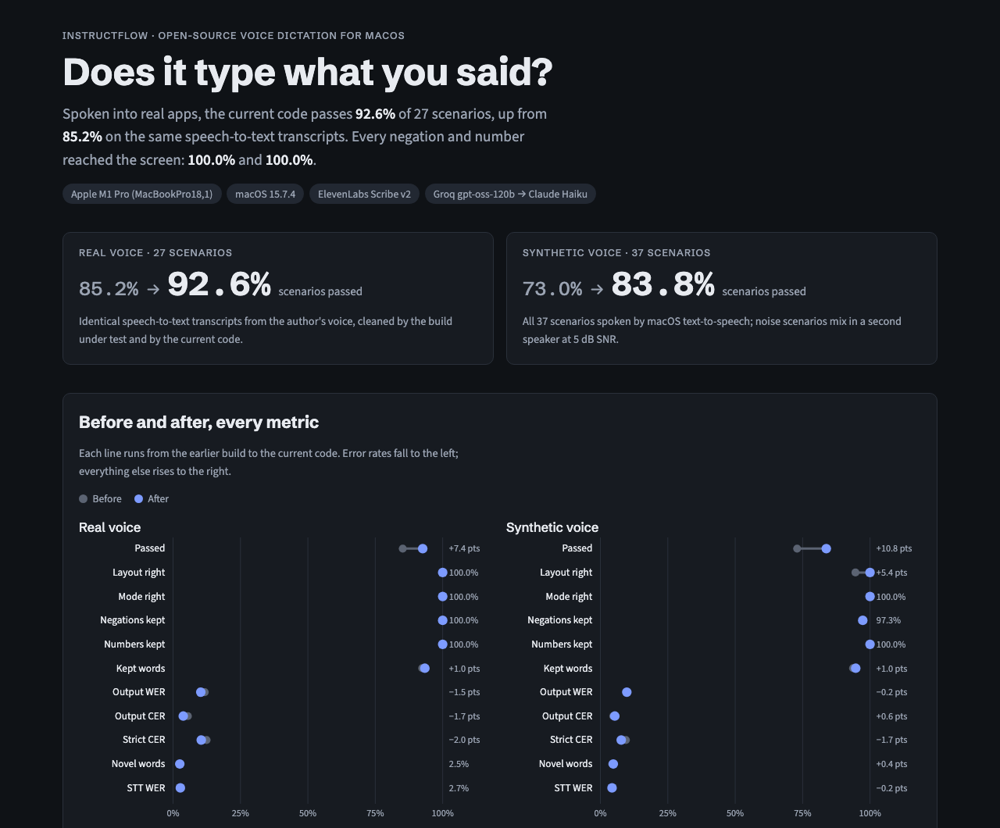
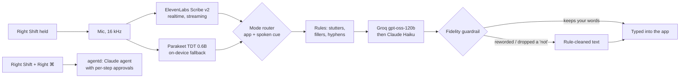

# Aloud

**Voice dictation for macOS that keeps your words, and a voice interface for coding agents.**

Hold Right Shift, talk, let go: your speech is typed into whatever app has focus. Aloud looks at
*where* you are dictating and cleans the text accordingly. It removes the "um"s, applies "no wait, Friday"
corrections and fixes punctuation, but it doesn't rewrite what you said. A spoken question is typed, never
answered. Add Right ⌘ to the chord and the sentence becomes a **task** for a local agent that works in
folders you allow, asking before every step that changes something.

It's an open-source, local-first alternative to tools like Wispr Flow and Superwhisper, built for
developers who spend their day talking to Claude Code, Codex and Cursor.

| You say, in… | Aloud types |
|---|---|
| **Notes**: "um so I was thinking that we should uh move the meeting to Thursday because no wait Friday works better" | So I was thinking that we should move the meeting to Friday, because Friday works better. |
| **Notes**: "grocery list eggs milk two loaves of bread and spinach" | Grocery list:<br>- Eggs<br>- Milk<br>- Two loaves of bread<br>- Spinach |
| **Gmail**: "hi Sarah just checking in on the contract let me know if you need anything thanks Shekhar" | Hi Sarah,<br><br>Just checking in on the contract. Let me know if you need anything.<br><br>Thanks,<br>Shekhar |
| **WhatsApp**: "lol yeah that works for me see you at 5" | Lol, yeah, that works for me. See you at 5. |
| **ChatGPT**: "what's the difference between a process and a thread" | What's the difference between a process and a thread? *(typed, not answered)* |
| **Claude Code**: a request that asks for several things, no cue needed | Goal / Tasks / Context / Constraints / Done when, in your own sentences, file names in `backticks` |
| **A shell prompt**: "git checkout dash b fix slash auth" | `git checkout -b fix/auth` *(typed, not run)* |

## Results

**Measured, not claimed.** Every scenario is spoken into a real app, and the harness checks what reached the
screen against what was said. Full numbers: [**BENCHMARKS.md**](BENCHMARKS.md) ·
interactive page: [**slm-llm-research.github.io/aloud/results**](https://slm-llm-research.github.io/aloud/results/)

| | Before | After |
|---|---|---|
| **Real voice**, 27 scenarios in Notes, Gmail, WhatsApp, Claude desktop, Claude Code (same transcripts, before vs after the fixes) | 85.2% passed | **92.6% passed** |
| **Synthetic voice**, all 37 scenarios incl. background noise (text-to-speech → live speech-to-text → the app's cleanup) | 73.0% passed | **83.8% passed** |
| Negations ("not", "don't") kept, real voice | 100.0% | **100.0%** |
| Layout right for the app (lists, email lines, prompt sections), synthetic | 94.6% | **100.0%** |
| Speech-to-text word error rate, real voice | 2.7% | 2.7% |
| Key release to text typed, median | 413 ms | 375 ms |

By app, real voice, current code: Notes 100.0% · Gmail (Chrome) 100.0% · WhatsApp 75.0% · Claude Code (Terminal) 75.0% · Claude desktop 100.0%.

[](https://slm-llm-research.github.io/aloud/results/)

## Contents

- [How it works](#how-it-works)
- [Requirements](#requirements)
- [Setup](#setup)
- [Using it](#using-it)
- [How the text is cleaned](#how-the-text-is-cleaned)
- [Task mode: the local agent](#task-mode-the-local-agent)
- [Privacy and where your data goes](#privacy-and-where-your-data-goes)
- [Results](#results)
- [Evals: measured, published accuracy](#evals-measured-published-accuracy)
- [Development](#development)
- [Project layout](#project-layout)
- [Roadmap](#roadmap)
- [Contributing](#contributing)
- [License](#license)

## How it works



1. **Speech to text.** Audio streams to ElevenLabs Scribe while you talk, so the transcript is ready
   about 150 ms after you let go. If there's no key, no network, or Scribe is slow, the on-device
   Parakeet model (Apple Neural Engine, via [FluidAudio](https://github.com/FluidInference/FluidAudio))
   transcribes instead.
2. **Mode routing.** The focused app, its window title and any spoken cue pick one of seven modes:
   prose, email, chat, list, AI chat, coding agent, or shell.
3. **Cleanup.** Deterministic rules run first (stutters such as "sub- sub-agent", hesitation sounds,
   look-alike Unicode hyphens). Then a fast LLM gets a strict "edit, don't answer" prompt with a mode-specific
   block. The transcript is passed as data inside tags, never as instructions.
4. **Fidelity guardrail.** Every model output is checked against what you said: content-word recall
   and precision, every negation, every number, no answering, no leaked prompt. A failed output moves to
   the next model, and if every model fails, the rule-cleaned text is typed. The model can't put words in
   your mouth.
5. **Insertion.** The text is pasted into the focused app (clipboard saved and restored) or typed key by key
   where pasting doesn't work. Nothing is ever submitted: no Enter is pressed.

## Requirements

| | |
|---|---|
| Mac | Apple Silicon, macOS 14 Sonoma or later |
| Swift | Swift 6.1 toolchain: Xcode 16.4+ or the matching Command Line Tools (`swift --version`) |
| Node.js | 22 or later, only for task mode (`brew install node`) |
| Python | [uv](https://docs.astral.sh/uv/), only for the benchmarks and evals (`brew install uv`) |
| API keys | All optional, see below |

**API keys.** Aloud works without any keys: it then uses the on-device model and rule-based
cleanup only. Each key turns on one part:

| Key | Used for | Get one |
|---|---|---|
| `ELEVENLABS_API_KEY` | Cloud speech-to-text (Scribe v2 realtime): faster and more accurate than on-device | [elevenlabs.io](https://elevenlabs.io/app/settings/api-keys) |
| `GROQ_API_KEY` | First-choice cleanup model (gpt-oss-120b, ~200 ms) | [console.groq.com](https://console.groq.com/keys) |
| `ANTHROPIC_API_KEY` | Fallback cleanup model (Claude Haiku) and the task agent (Claude Opus) | [console.anthropic.com](https://console.anthropic.com/settings/keys) |

## Setup

### 1. Get the code

```bash
git clone https://github.com/slm-llm-research/aloud.git
cd aloud
```

### 2. Build the app

```bash
cd app
swift test              # ~200 unit tests, a few seconds, no permissions needed
scripts/bundle.sh       # builds app/build/Aloud.app (release) and signs it
open build/Aloud.app
```

The first build downloads Swift packages. The first launch downloads the Parakeet model (~600 MB) in the
background; the menu shows "speech model ready" when it's done.

**Optional, but saves re-granting permissions:** `bundle.sh` signs ad hoc by default, which changes the
app's identity on every rebuild, so macOS asks for permissions again after each one. Run once:

```bash
scripts/make-signing-cert.sh
```

That creates a self-signed code-signing identity in a keychain of its own (no admin password, nothing
added to your login keychain). After that, every `bundle.sh` signs with it and macOS remembers the
permissions across rebuilds.

### 3. Grant permissions

On first launch, macOS asks for three permissions. Turn on Aloud in **System Settings → Privacy &
Security** under:

- **Microphone**: to hear you while the key is held.
- **Input Monitoring**: to see Right Shift (Aloud only reacts to its own keys; Tab, Shift+Tab and
  everything else pass through untouched).
- **Accessibility**: to type into the focused app.

The app picks them up within a few seconds. Its menu-bar icon shows the status, and **Permissions…** in
the menu opens the right settings pane.

### 4. Add your API keys

Put the keys in a file, using `.env.example` as the template:

```bash
cp .env.example .env    # then fill in the keys you have
```

Then choose **Import API Keys from .env…** in Aloud's menu and pick the file. The keys are copied
to `~/Library/Application Support/Aloud/keys.env` (mode 0600, readable only by you). They are not
stored in the Keychain, so no password prompts appear. `.env` is gitignored, so the keys never end up in
the repository.

### 5. Task mode (optional)

```bash
cd agentd
npm install
npm run build           # -> agentd/dist/main.js; the app starts it automatically
npm test
```

Restart Aloud. The menu's agent line shows that it's connected. Then open **Agent Settings…** and add the
folders the agent may work in. **By default it has none**, so it can't touch anything until you choose.
To let it tidy your Desktop, add `~/Desktop`; the first time it looks there, macOS asks whether Aloud may
access your Desktop folder. Click Allow.

## Using it

| Keys | What happens |
|---|---|
| Hold **Right Shift**, talk, release | Dictate into the focused app |
| **Double-tap Right Shift** | Hands-free: the mic stays open; tap Right Shift again to finish |
| **Esc** while recording | Cancel; nothing is typed |
| Hold **Right Shift**, add **Right ⌘**, talk, release | Task mode: the sentence goes to the agent instead of being typed |

While the mic is open, a pill at the bottom of the screen shows a live waveform that moves with your
voice (white for dictation, orange for an agent task) and settles to a slow pulse when you pause, so you
can see it's hearing you. Right Shift alone types nothing, so holding it never interferes with typing. Tab is never intercepted,
so Shift+Tab (for example Claude Code's mode switch) always works.

**Spoken cues** override the app's mode for one dictation. The cue is removed from the text:

- "… **as a prompt**": always lay the request out as a prompt. Usually not needed: in a coding agent, requests are
  laid out automatically and free speech stays as you said it. Talking *about* the phrase ("… that this is X as a
  prompt") doesn't trigger it.
- "… **make this a list**": one item per line.
- Starting with "**grocery list**", "**to-do list**", "**packing list**" …: a titled list.

**Menu.**
- **Offline mode:** on-device speech only, no network.
- **AI cleanup:** turn LLM cleanup on or off; rules still run.
- **Edit Dictionary…:** words to always spell your way, and "heard → written" fixes.
- **Agent Settings…:** the agent's folders and model.
- **Open Log:** a diagnostic log with each dictation's mode, latency and cleanup path.

**Personal dictionary**, at `~/Library/Application Support/Aloud/dictionary.txt`:

```text
# Terms to spell exactly (also sent to speech-to-text as hints):
Claude Code
FastAPI
authCheck.ts
# Fixes for words that keep being misheard:
fast appy -> FastAPI
agent d -> agentd
```

## How the text is cleaned

Each dictation gets a **mode** and an **edit level**:

| Mode | Picked when | What changes |
|---|---|---|
| Prose | Notes, docs, any app not listed below | Fillers, false starts, self-corrections, punctuation. Your words, your order. |
| Email | Mail, Outlook, a Gmail/Outlook tab | Same, plus your spoken greeting and sign-off on their own lines. Nothing added. |
| Chat | Slack, Messages, WhatsApp, Discord, Teams | Same, casual tone kept ("lol" stays "lol", "at 5" stays "5") |
| List | Reminders, Things, or a list cue | One item per line; a correction replaces its item |
| AI chat | ChatGPT, Claude, Gemini apps and sites | One cleaned prompt, **never answered** |
| Coding agent | Claude Code / Codex / Aider in a terminal, Cursor, VS Code, Zed, Xcode, the Codex app | Identifiers in `code form`. Aloud decides from what you said: a request (asks, plus constraints, more tasks or a "done when") is laid out as Goal / Tasks / Context / Constraints / Done when using **your sentences**; free speech (thinking aloud, feedback, explaining) stays as your sentences with only punctuation and fillers fixed. A short single ask stays one sentence. |
| Shell | A terminal at a plain shell prompt | One line, spoken symbols as symbols ("dash b" → `-b`), never run |

**Misheard words.** Before cleanup, a separate pass looks for words the recognizer got wrong. These
are usually caused by background noise or rare names, for example "poll request" for "pull request" or a
stray word inside "Shift plus Command". The model doesn't rewrite anything: it only names each wrong span
and what was meant, and Aloud applies the fix itself, only if:
- the span appears exactly once;
- at most a couple of words change;
- no "not" or "never" is added or removed.

Correct but unusual words stay ("my cup is on the desk"). Every fix is written to the log ("repaired:
poll request -> pull request"). Shell commands are never repaired. Turn it off with **Fix misheard words**
in the menu.

**What the guardrail rejects** (the next model is tried, then the rule-cleaned text):
- **Rewording:** too many of your content words missing, or too many new ones.
- **Meaning flips:** a "not", "never" or "don't" added or dropped.
- **Dropped numbers.**
- **Answering instead of editing**, and **leaked prompt text**.
- **Fused stutters:** "sub-sub-agent" when you didn't say it.

The design and the research behind it are in [`research/06-intent-aware-cleanup.md`](research/06-intent-aware-cleanup.md).

## Task mode: the local agent

`agentd` is a small Node/TypeScript daemon. It runs a Claude agent (Opus by default) with a fixed set of
tools, each of which declares its effects. Anything that writes, runs or opens something needs your
approval first.

**The agent island.** While a task runs, a small capsule at the top of the screen (hanging from the
notch on MacBooks) shows what the agent is doing: the step in progress, "2/4" from its plan, and the
elapsed time. Rest the pointer on it to see what it heard, the plan as a checklist, each tool step with its result
and timing, and a stop button. When a step needs you, the island turns into an approval card in place
with a risk badge, a plain title ("Run git status in aloud"), the exact command or a coloured diff,
and a countdown to the automatic deny. It never takes focus from the app you're in; click the card and
⌘↩ approves, Esc denies, ⌘. stops the task.

**Task Center** (menu bar ▸ Task Center…, or "Open Task Center" in the island) is the full view: every
task, running or past, filterable and searchable, with what it heard, the result, the plan, each step's
result, timing and risk, token counts, and any approval it's waiting for (approve or deny from there).
Past tasks are rebuilt from the audit log, so they survive restarts.

| Tool | Effect | Approval |
|---|---|---|
| `list_dir`, `find_files`, `find_folders`, `search_files`, `read_file` | Read inside allowed folders | No |
| `write_file` | Write inside allowed folders | Yes, with a preview |
| `organize_files` | Move a batch of files and folders into folders ("organize my desktop") and remove empty leftover folders; never overwrites or deletes anything with content | Yes, once for the whole batch, grouped by destination |
| `undo_organize` | Put the last organized batch back ("undo that") and remove the folders it created if empty | Yes |
| `arrange_desktop` | Sort the Desktop's icons by name, kind, date or size (Finder's Sort By); no files move | No. The first time, macOS asks whether Aloud may control Finder |
| `run_shell` | Run allowlisted programs (`git`, `npm`, `swift`, `pytest`, …) in an allowed folder; every program in a pipeline must be allowlisted, no command substitution or redirection | Yes |
| `claude_code_task` | Hand a coding task to Claude Code in an allowed repo (edits only, no shell or web) | Yes |
| `open_app`, `open_url` | Open an application or a web page | Yes |

- **Approvals:** an approval you don't answer is denied after two minutes.
- **Audit log:** every step is written to `~/Library/Logs/Aloud/agent-audit.jsonl`.
- **Kill switch:** **Stop All Agent Tasks** in the menu.
- **Configuration:** `~/Library/Application Support/Aloud/agent.json` holds the allowed folders,
  model and effort level.

## Privacy and where your data goes

- **Audio:** sent to ElevenLabs only when an `ELEVENLABS_API_KEY` is set and Offline mode is off.
  Otherwise everything stays on your Mac.
- **Transcripts:** sent to Groq and/or Anthropic only for cleanup, when their keys are set and AI cleanup
  is on. The prompt contains the transcript, your dictionary terms and, for developer and AI-chat modes,
  the target app's name.
- **Window titles:** read locally to pick the mode, and never sent anywhere.
- **Logs:** the diagnostic log and `dictations.jsonl` (used by the evals) stay in `~/Library/Logs/Aloud/`
  on your Mac and contain your transcripts, so delete them whenever you like. The eval harness strips email
  addresses from window titles before it saves any result.
- **Keys:** `~/Library/Application Support/Aloud/keys.env`, mode 0600.

## Evals: measured, published accuracy

Most dictation tools don't publish how often they get things wrong. Aloud ships its eval harness and
its results.

[`bench/scenarios.jsonl`](bench/scenarios.jsonl) has 37 scenarios across every mode: self-corrections,
negations, numbers, names, slang, stutters, instruction-shaped sentences that must not be carried out, shell
symbols, and five background-noise variants. Each gives where to dictate, what to say, the expected text
and checks.

```bash
cd bench
uv sync

# You speak each scenario into the real app; the harness pairs it with what the app heard and typed.
uv run python scenario_eval.py run

# No human: macOS text-to-speech -> live speech-to-text -> the app's own cleanup code (~3 minutes).
uv run python scenario_eval.py replay

# Re-clean an earlier session's transcripts with the current code (a fair before/after on identical input).
uv run python scenario_eval.py reclean --session 20261031

uv run python scenario_eval.py report                       # Markdown + JSON report in bench/results/
uv run python scenario_eval.py compare SESSION1 SESSION2    # before/after table
```

| Metric | Measures |
|---|---|
| **Pass rate** | Required phrases present, banned phrases absent, layout right for the app, every negation and number kept, right mode chosen |
| **STT WER / CER** | Speech-to-text accuracy against the script (normalized) |
| **Output WER / CER** | Whether the right words reached the screen (normalized) |
| **Strict CER** | Exact characters, including punctuation and line breaks, so it measures layout |
| **Novel-word rate** | Words on screen you never said: rewording, or a mishearing |
| **Kept-word recall** | Your words that made it to the screen |
| **Latency p50 / p95** | Key release to text typed |

Results from 2026-10-31. [BENCHMARKS.md](BENCHMARKS.md) breaks them down by app, mode and noise, scenario by scenario; raw reports are in [`bench/results/`](bench/results/). `uv run python export_results.py` regenerates BENCHMARKS.md and the results page from the saved sessions.

| Run | Scenarios | Pass | STT WER | Output WER | Strict CER | Negations kept | p50 / p95 |
|---|---|---|---|---|---|---|---|
| Real voice, build at the time of testing | 27 | 85.2% | 2.7% | 11.8% | 12.4% | 100% | 413 / 789 ms |
| Real voice, same transcripts, current code | 27 | **92.6%** | 2.7% | 10.3% | 10.5% | 100% | 375 / 1701 ms |
| Synthetic voice (TTS replay), current code | 37 | 83.8% | 4.3% | 9.8% | 7.7% | 97.3% | 425 / 831 ms |

Most remaining failures happen at the speech-to-text step, before the cleanup sees the text: "omg" spelled
out as "Oh my God", a synthetic voice's "auth" heard as "off", and words lost when another person talks at
the same volume. They're listed scenario by scenario in the reports.

There are also component benchmarks:
- `stt_bench.py`: speech-to-text engines (Parakeet, Whisper, ElevenLabs, Groq) on LibriSpeech and on
  technical and filler-heavy clips.
- `cleanup_bench.py`: cleanup models.

`uv run python build_dataset.py` builds their audio. See [`bench/README.md`](bench/README.md).

## Development

```bash
# Swift app
cd app
swift test                                           # unit tests
set -a; source ../.env; set +a                       # load keys for live tests
ALOUD_INTEGRATION=1 swift test --filter "ModesLive|CodingLive"   # real Groq/Haiku calls
ALOUD_INTEGRATION=1 swift test --filter ScribeLive              # real ElevenLabs session
scripts/bundle.sh && open build/Aloud.app

# Agent daemon
cd agentd
npm test
ALOUD_INTEGRATION=1 npm test                  # real Claude calls

# Evals
cd bench
uv run python scenario_eval.py selftest
```

The diagnostic log is the first stop for any problem:

```bash
tail -f ~/Library/Logs/Aloud/aloud.log
```

Each dictation logs a line with the mode it picked and why, the speech-to-text source and latency, the
cleanup path (`groq`, `haiku`, `skipped`, `fallback`) with any guardrail rejection, and what was heard and
typed.

## Project layout

```text
app/                     macOS menu-bar app (Swift 6.1, SwiftPM, no Xcode project)
  Sources/HotkeyKit/     Right Shift / Right ⌘ chord state machine and CGEventTap
  Sources/AudioKit/      mic capture, 16 kHz mono resampling
  Sources/STTKit/        Scribe realtime client, Parakeet on-device model
  Sources/CleanupKit/    mode router, rule passes, prompts, LLM clients, fidelity guardrail
  Sources/InsertKit/     clipboard-safe paste and key typing
  Sources/AgentKit/      agentd process, socket client, task store
  Sources/AgentUI/       the agent island (task pill, plan drawer, approval card) and the Task Center
  Sources/AloudCore/  session: record -> transcribe -> clean -> insert
  Sources/Aloud/  app, menu, HUD, permissions
  Tests/                 unit tests, live tests (opt-in), scenario replay
  scripts/               bundle.sh, make-signing-cert.sh
agentd/                  local agent daemon (Node 22, TypeScript, Anthropic SDK)
bench/                   speech-to-text and cleanup benchmarks, scenario eval harness, results
docs/results/            the benchmark page (GitHub Pages), its data and screenshot
BENCHMARKS.md            before/after results by app, mode and noise
research/                design research: product teardowns, model options, macOS integration, cleanup design
PLAN.md, PLAN-SIMPLE.md  architecture and milestone plans
```

## Roadmap

- Command mode (Right Shift + Right Option): edit the selected text by voice ("make this shorter").
- Tell an editor's code buffer apart from its AI chat panel (Accessibility field role).
- An undo / switch-mode chip after each insertion.
- Opt-in noise suppression, measured against the noise scenarios first.
- A larger eval set: more voices, accents, recorded noise.
- `@file` mentions and project vocabulary learned from the open repository.

## Contributing

Issues and pull requests are welcome. Good first contributions:
- **A new app routing:** add a bundle ID to `app/Sources/CleanupKit/AppProfiles.swift` or `Modes.swift`,
  with a test in `ModeTests.swift`.
- **A new eval scenario:** add a line to `bench/scenarios.jsonl`, with the expected text written to keep the
  speaker's words.
- **A failing dictation:** open an issue with the "heard" and "typed" lines from the log.

Run `swift test`, `npm test` (in `agentd/`) and `uv run python scenario_eval.py selftest` before opening a PR.
Never commit API keys: `.env` is gitignored, so keep keys there or in the app's `keys.env`.

## License

[Apache License 2.0](LICENSE). Copyright 2026 Shekhar Tanwar. You may use, modify and distribute it, including
commercially; the license also grants the contributors' patent rights. See [`NOTICE`](NOTICE).

Aloud uses [FluidAudio](https://github.com/FluidInference/FluidAudio) and NVIDIA's Parakeet TDT
0.6B v2 model (CC-BY-4.0) for on-device speech, and the ElevenLabs, Groq and Anthropic APIs under their
own terms.
