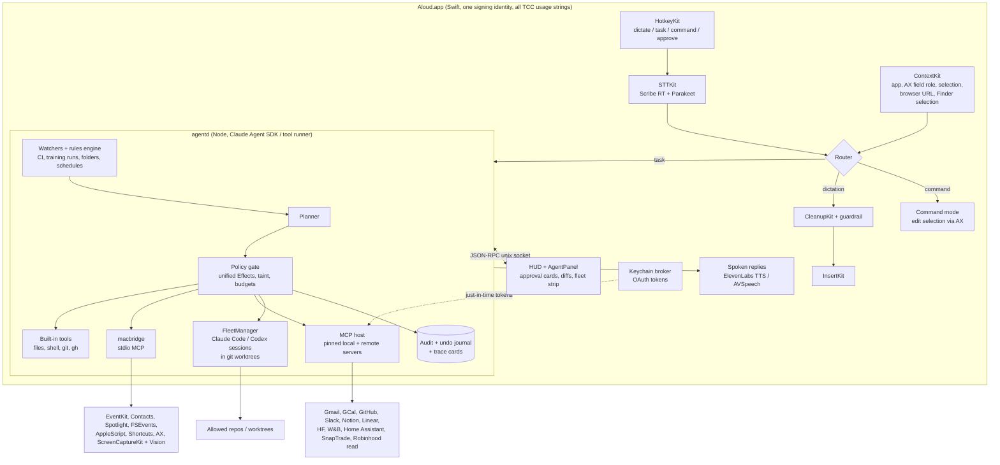

# 07. From Dictation to a Voice-Driven Agentic OS: Research Report

*Research date: 2026-10-31. Scope: how Aloud can grow from "dictation that keeps your words" plus a task agent into a voice layer that safely acts across the Mac, web services and developer tools.*

This is the synthesis. Four appendices hold the detailed research, tables and sources:

| Appendix | Topic | Size |
|---|---|---|
| [A. macOS bridges](A-macos-bridges.md) | AppleScript/JXA, Shortcuts/App Intents, EventKit, Spotlight/FSEvents, Accessibility, screen + OCR, computer use, a `macbridge` helper design, 40 voice tasks | ~6.7k words |
| [B. MCP ecosystem](B-mcp-ecosystem.md) | MCP spec state (2026-07-28), the agentd MCP host design, OAuth + Keychain, an effect mapping for MCP tools, ~50 servers, read-only finance, security threats and mitigations | ~5.8k words |
| [C. Competitors and moat](C-competitors-and-moat.md) | Survey of ~25 products, a feature matrix, 8 market gaps, voice UX research, 22 moat features with prioritisation | ~6.3k words |
| [D. Developer workflows](D-developer-workflows.md) | Voice fleet control for parallel coding agents, ~50 git/CI/review/ML workflows, ambient watchers, effect additions | ~6.4k words |

Facts about third-party products were checked against sources as of 2026-10-31 and are cited in the appendices. Where a sub-report flagged a claim as resting on secondary sources only, it is marked *(unverified)* here too.

---

## 1. TL;DR

1. **The market has split, and the gap sits between the two halves.** Dictation apps (Wispr Flow, Superwhisper, VoiceInk, FluidVoice, OpenWhispr, Aqua, Willow) stop at "edit the selection" or "ask a chatbot". Agent platforms (ChatGPT + Codex, Claude Cowork / computer use / Claude in Chrome, Perplexity, Raycast, Siri with App Intents) treat voice as a side chat. **No product combines dictation-grade voice with a governed local agent**: typed effects, approvals built from the actual tool call, an audit log, and published reliability numbers. Aloud already has most of that foundation (`agentd`'s ToolContracts, Effects, gate, audit log and the `bench/` harness). The strategy is to extend it rather than pivot. [C §1.4]
2. **Positioning line:** *"The open-source voice layer for your Mac that does things, shows you exactly what it will do before it does it, and publishes how often it gets it right."* That plays to an evals and agent-safety background, which is what Anthropic, OpenAI and DeepMind hire for. [C §3]
3. **Three bridges get you "everything on the Mac":**
   - **`macbridge`**: a Swift helper bundled in the app, exposed to agentd as a local MCP server over stdio. It covers Calendar, Reminders, Contacts, Spotlight, folder watching, Mail/Notes via AppleScript, Shortcuts, windows, screen + OCR, and Accessibility.
   - **An MCP host inside agentd** for web services: Gmail, Google Calendar, GitHub, Slack, Notion, Linear, Hugging Face, W&B, Home Assistant, finance.
   - **A FleetManager** built on the Claude Agent SDK, for running several coding agents in git worktrees by voice. [A §A.3, B §1.7, D §1.2]
4. **The safety model is the product.** Unify the effect proposals from all four appendices into one taxonomy (section 5). The key additions are:
   - `read_private` and `read_remote` (auto, but results tagged untrusted)
   - `ui_input` (synthetic input into other apps)
   - `trash_local` (reversible delete)
   - `spend_compute` (paid jobs, with a budget card)
   - `vcs_publish` (push, PR, merge)
   - a reversible-settings carve-out
   
   Spoken approval is never accepted for send, spend, publish or delete. Approval cards are rendered from the typed call, never from the model's prose.
5. **Finance is possible and must stay read-only.** Robinhood launched an official Trading MCP in May 2026; it reads accounts and trades in a separate agentic account. Mount only its read tools, hard-block order tools as `spend_money`, prefer SnapTrade's read-only multi-broker MCP, and never use unofficial scraping libraries. [B §3]
6. **Flagship demos for a portfolio, ranked:**
   1. a public **Reliability Ledger** with shareable **trace cards**
   2. **voice fleet control** of several Claude Code sessions ("status?" → a two-sentence spoken verdict)
   3. **"organize my Downloads"** with a dry-run diff, one approval and one-step undo
   4. **standing folder rules** ("from now on, file every invoice PDF…")
   5. a spoken **morning brief** built from git, CI, calendar and overnight training runs
7. **Build order (about 10 to 12 weekends of work):** unified effects and approval cards → `macbridge` reads → MCP host + Gmail/Calendar/GitHub → dry-run + undo for file ops → FleetManager → ambient watchers and the brief → screen/AX deixis and Command mode → learned macros, timeline memory, finance → publish the ledger. Section 8 has the detail.

---

## 2. Where Aloud stands today

What already exists, read from the code (`app/`, `agentd/`, `bench/`):

| Layer | Today | Gap toward an "agentic OS" |
|---|---|---|
| Trigger | Right Shift = dictate; Right Shift + Right ⌘ = task; double-tap = hands-free | No Command mode (edit selection) yet; no voice approval; no status channel |
| Context | Focused app, bundle ID and window title, passed to agentd | No selection text, AX field role, browser URL, Finder selection or screen text |
| Agent | `agentd`: Claude Opus via the SDK tool runner; 10 tools (files, shell allowlist, `claude_code_task`, open app/URL) | No MCP, no Mac frameworks, no multi-agent orchestration, no scheduling or watchers |
| Safety | Typed `ToolContract` with `effects()`, `preview()` and `check()`; gate (block, confirm, auto); allowed roots; audit JSONL; kill switch; 2-minute timeout | Effects are too coarse for private reads, UI input, remote reads or compute spend; there's no taint tracking, dry run or undo |
| Output | AgentPanel approval cards; a short text summary | No TTS, no diff viewer, no persistent task list |
| Evals | 37 dictation scenarios with published WER/CER/latency | No task-success or false-action evals for agent mode |

The architecture is already the right shape. `ToolContract` + `Effect` + `gatedRun` is a clean seam, so every new capability below becomes "a new tool source whose tools map to Effects". That's the design principle the whole report follows.

---

## 3. Target architecture

Four architectural decisions, each argued in an appendix:

1. **Write `macbridge` yourself, in Swift, inside the app bundle.** Don't mount community Mac MCP servers. macOS's privacy system (TCC) credits every permission prompt to the "responsible process". With an app → agentd → macbridge chain, every prompt names Aloud and every grant is scoped to it. Third-party servers would each bring their own identity and broad, unaudited tools. Borrow code from the MIT-licensed ones (iMCP for Calendar/Contacts, Peekaboo's UI-map approach, macos-automator-mcp's script library); apple-mcp was archived in January 2026. [A §A.0, §A.2]
2. **Run a client-side MCP host in agentd, not the Anthropic API's MCP connector, for anything that writes.** The connector runs tool calls on Anthropic's side within one API call, so agentd can't step in for approval, and it can't reach local stdio servers. Use the v2 TypeScript MCP client against spec 2026-07-28, pin every server version and tool-list hash, and keep OAuth tokens in the Keychain, brokered by the Swift app and never placed in model context. [B §0, §1.7]
3. **Move coding-agent orchestration to the Claude Agent SDK.** Its `canUseTool` callback maps one-to-one onto approval cards, and `setPermissionMode()` lets "accept edits from now on" work by voice. Keep `claude -p --output-format stream-json` as a fallback, and put Codex and Cursor behind the same `FleetBackend` interface. Launch agents with `--bare` in untrusted repos, because a `-p` run otherwise executes the repo's hooks and `.mcp.json` servers without a trust prompt. [D §0, §1.2]
4. **Route each action to the most structured interface available:** native framework > AppleScript dictionary > Shortcuts / App Intents > URL scheme > Accessibility > screenshot + OCR > computer use. Each step down is slower and harder to verify, so it gets a stricter approval level. Computer use sits last, behind an explicit "takeover" approval with a visible screen border. [A §A.0]

---

## 4. The feature catalogue

Features are grouped by the surface they touch. Each row says what you say, what runs, its effect class and difficulty (S = days, M = 1 to 2 weeks, L = longer or fragile). The appendices have 130+ concrete voice tasks; this is the curated set worth building.

### 4.1 Your Mac (via `macbridge`)

| You say | What runs | Effect | Diff. |
|---|---|---|---|
| "Organize my Downloads by type" | Spotlight listing → `files.organize_plan` → the AgentPanel shows a diff of moves → one approval runs the batch atomically, with an undo journal | write_local | M |
| "From now on, file every invoice PDF in Downloads into Finance/Invoices" | FSEvents **standing rule** + text/OCR classifier; approve once at creation, then a daily digest | write_local (rule) | L |
| "Find the PDF Priya sent last week" | Spotlight on download source + date + type, falling back to Mail attachments, then Gmail MCP | read_local / read_private | M |
| "Delete the DMGs older than a month" | Spotlight + `NSWorkspace.recycle` (Trash, so reversible) | trash_local | S |
| "What's on my calendar after 3?" / "Am I free Thursday for an hour?" | EventKit (+ Google Calendar MCP for work calendars) | read_private | S |
| "Block 2 to 4 tomorrow for deep work" | EventKit create | write_local | S |
| "Remind me to call Mom when I get home" | EventKit reminder with a location alarm | write_local | M |
| "Set up my coding layout" | Open apps + AX window arrangement preset | launch_app, ui_input:window | M |
| "Summarize what's on my screen" / "What does this error dialog mean?" | AX text of the front window, falling back to ScreenCaptureKit + Vision OCR | read_private | S |
| "Turn the table on screen into a spreadsheet" | Vision document recognition → CSV → open in Numbers | read_private, write_local | M |
| "Save this page to Obsidian under Reading" | Browser tab via AppleScript + `obsidian://` URL scheme | read_private, write_local | M |
| "Draft a reply to the last email from Sam saying I'll review tomorrow" → "send it" | Mail.app AppleScript or Gmail MCP draft; sending is a separate step | write_local → send_message (click only) | M |
| "Text my wife I'm leaving in 10 minutes" | Contacts resolve → Messages send, with the exact text on the card | send_message (click only) | M |
| "Turn on Work focus until 6" / "Dark mode" / "Volume 30" | Tagged Shortcuts / System Events, with stored undo | system_settings:reversible | S |
| "Join my next meeting" | EventKit next event → extract the Zoom/Meet link → open | read_private, open_url | S |
| "Run my morning shortcut" | `shortcuts run` on an Aloud-tagged shortcut (the official route to other apps' App Intents) | per tag | S |
| "Photos of the whiteboard from Tuesday into a note" | PhotoKit date fetch + Vision OCR + Notes create | read_private, write_local | M |

### 4.2 Web services (via the MCP host)

| You say | Server(s) | Effect | Notes |
|---|---|---|---|
| "Any emails from recruiters I haven't answered?" | Gmail (Google Workspace MCP, developer preview; drafts but doesn't send) | read_remote | Request the minimum scopes: `gmail.readonly` + `gmail.compose` |
| "What's blocking me on Linear this sprint?" | Linear MCP | read_remote | |
| "Post in #eval-team that the run finished" | Slack official MCP (GA Feb 2026) | send_message (click) | Needs a Slack app |
| "Add this to my reading list in Notion" | Notion MCP | network_write | |
| "Turn off the living room lights" | Home Assistant built-in MCP (OAuth) | physical_actuation | Locks and garage doors stay blocked |
| "What's trending on Hugging Face for speech?" | Hugging Face MCP | read_remote | |
| "How are my investments doing?" / "What moved my portfolio today?" | SnapTrade (read-only, multi-broker) + Robinhood MCP read tools + a market-data MCP that receives tickers only | read_remote + `sensitive_financial` | Moves are computed locally; trading is blocked (section 6) |

### 4.3 Developer and ML work (FleetManager + `gh` + MCP)

| You say | What runs | Effect |
|---|---|---|
| "Spin up three agents on the eval repo: retry logic, scorer tests, README" | 3 worktrees + 3 Agent SDK sessions, with acoustically distinct nicknames (alpha, bravo, charlie) | one confirm card for the batch |
| "Status?" | Cached per-agent summaries → one spoken sentence, ordered: waiting on you > failed > done > working | read (auto, no LLM in the hot path) |
| "What's bravo stuck on?" → "Approve" / "Deny, use pydantic instead" | Resolves `canUseTool`; a denial carries the reason back to the agent | voice approval only for `execute_process` inside a worktree |
| "Show me alpha's diff" / "Merge alpha" | `git diff main...fleet/alpha` on the HUD / `gh pr create` | read / vcs_publish (click only) |
| "Why did CI fail?" / "Rerun the failed jobs" | `gh run view --log-failed`, summarised / `gh run rerun --failed` | read_remote / network_write (voice-approvable: idempotent) |
| "Write a commit message for what I staged" | `git diff --staged` → message inserted via InsertKit | read_local |
| "Explain the last terminal error" | iTerm2 API / AppleScript / AX buffer read, with secrets redacted, then a click-to-insert fix | read_private |
| "How's the loss on sft-v3?" | W&B / MLflow via a small Python MCP sidecar → spoken trend + chart on the HUD | read_remote |
| "Launch the eval job on an A10G, max 2 hours" | HF Jobs / RunPod | spend_compute (budget card, click) |
| "What was I doing in this repo?" | branch, reflog, stash, uncommitted diff, last Claude Code session summary, audit entries | read_local |

### 4.4 Ambient and proactive (watchers + interruption policy)

These need no hotkey. They run as watchers in agentd and speak **at most one sentence per event**. They never speak while the mic is hot, during a calendar meeting or while screen-sharing; they show a toast and queue the speech for "what did I miss?". [D §5]

| Feature | Trigger | Output |
|---|---|---|
| **Morning brief** | "Brief me", or the first unlock after 8 am | 30-second spoken summary (ElevenLabs TTS): yesterday's merges, review requests, CI states, today's meetings, overnight eval results; full standup text on the HUD |
| **CI watcher** | Armed automatically after a push or PR | "PR 413 failed in test_scorer. Want bravo to fix it?" |
| **Agent-needs-you nudge** | Claude Code `Notification` hook / a pending approval older than 90 s | "Charlie's been waiting two minutes for approval." |
| **Training-run watcher** | NaN loss, eval loss rising, throughput drop, idle GPU | "Run sft-v3 hit NaN at step 6,100. Cancel it?" |
| **Idle-compute sentinel** | A pod idle for more than N hours | "The 4090 pod has been idle 6 hours, about eleven dollars. Stop it?" |
| **Folder rules** | FSEvents | Files sorted silently; a digest at day's end |
| **Conditional rules** | "When the PR is green *and* the eval job finishes, tell me. If any slice regresses by more than 2 points, don't merge." | A small rule engine over the watchers |
| **End-of-day wrap** | "Wrap up" | Shipped work, uncommitted changes, running jobs; offers to stash a WIP commit |

---

## 5. One unified Effect model

The four sub-reports each proposed effect additions. Here they are merged into one taxonomy for `agentd/src/effects.ts`. Two rules hold throughout: **only a local, user-signed override can relax an effect** (never a server's own annotations), and **the approval card is rendered from the typed tool call, never from model-written prose**.

| Effect | Covers | Policy | Voice approval? | Source |
|---|---|---|---|---|
| `read_local` | files inside allowed roots | auto | n/a | existing |
| `read_private` | calendar, contacts, mail, messages, screen, selection, clipboard, photos | auto after a **per-session category grant**; results **tainted** | n/a | A |
| `read_remote` | authenticated API reads (GitHub, W&B, Gmail, HF, K8s get) | auto, audited, rate-limited; results **tainted** | n/a | B, D |
| `notify` | post a notification to the user | auto | n/a | A |
| `launch_app`, `open_url` | open apps and pages | auto (open_url to an unfamiliar domain: confirm) | yes | existing |
| `ui_input:window`, `ui_input:media` | window moves, media keys | auto | yes | A |
| `system_settings:reversible` | allowlisted toggles (Focus, dark mode, volume, audio output) with stored undo | auto | yes | A |
| `write_local` | create or change files, calendar events, reminders, notes | click; bulk operations show a dry-run diff | yes for single, reversible writes | existing |
| `trash_local` | move to Trash | click with a file list; over 20 files requires confirming the count | no | A |
| `execute_process` | allowlisted shell | click; voice OK inside fleet worktrees | worktree only | existing, D |
| `ui_input` | clicks or typing into other apps via AX | click per step, naming the target app and element | no | A |
| `network_write` | create or modify remote state (Notion page, rerun CI) | click; voice OK only for idempotent, reversible calls | limited | existing |
| `physical_actuation` | smart-home devices | confirm per entity class; locks, garage and alarm blocked | lights only | B |
| `spend_compute` | paid GPU jobs or pods | click + **budget card** (instance type, $/hr, timeout, max $); daily cap, then blocked | no | D |
| `send_message` | email, chat, comments, invites | click, exact payload shown | **never** | existing |
| `vcs_publish` | push, PR, merge, push_to_hub | click; merge shows diffstat + CI state | **never** | D |
| `delete_local`, `delete_remote` | permanent deletion | **blocked** (prefer `trash_local`) | — | existing, B |
| `spend_money` | purchases, trades, transfers | **blocked** | — | existing |
| `system_settings` (other) | everything not allowlisted | **blocked** | — | existing |
| `takeover` | computer-use control of the screen | explicit takeover approval + visible border + stop key | no | A |

**Taint rule.** Once a task has read tainted content (email, a web page, a PR body, CI logs, screen text), any later `send_message` or `network_write` must show the exact payload and where any private data in it came from. Instructions found inside tainted content are never turned into plan steps. If a task holds private data, has read untrusted content *and* has an outbound channel, each send needs a fresh click. That's the "lethal trifecta" check. [B §4.2]

---

## 6. Finance: what's possible and where the line is

| Source | What it gives you | How to use it |
|---|---|---|
| **SnapTrade hosted MCP** | Read-only positions and balances across many brokers; the read-only guarantee is enforced by the server | Primary source for "how are my investments doing?" |
| **Robinhood Trading MCP** (official, launched 2026-05-27; crypto added July) | Reads all your Robinhood accounts; trades only in a separate agentic account, with no documented read-only mode | Mount **only** account, portfolio, watchlist and quote tools by explicit allowlist; pin the tool hash; leave the agentic account unfunded. New tools stay disabled until you review them |
| **Robinhood Crypto API** | Keys can be scoped to read-only actions | A local wrapper for crypto balances |
| **Schwab Trader API** | Official individual developer API; community MCP servers only | Optional, read paths only |
| **Fidelity** | No public retail API | Not supported; don't scrape |
| **Unofficial libraries (robin_stocks etc.)** | Reverse-engineered access | **Don't use.** They risk breaking the terms of service and getting the account restricted |

*(Coinbase's agent MCP and the Interactive Brokers connector are described only in third-party write-ups; check them before relying on either.)*

**Design.** "What moved my portfolio today" is computed **locally**: position quantity × (last − previous close), ranked. Only tickers are sent to the market-data server. Account numbers are never spoken or pasted and are redacted from the audit log. While finance data is in context, a HUD badge shows it, and any send to another server needs an extra confirmation.

**Why trading stays blocked even with approval:** orders are irreversible; a speech-to-text slip on a quantity ("fifteen" vs "fifty") is likely; market news is a prompt-injection channel; and spoken approval can be spoofed. [B §3.3]

---

## 7. Moat features: what nobody else ships

From the competitor survey [C §1.4, §3] and developer research [D §6], these are the capabilities that don't exist in any shipping product as of 2026-10-31, ranked by value to the portfolio goal:

| # | Feature | Why it's a moat | Diff. |
|---|---|---|---|
| 1 | **Public Reliability Ledger + trace cards.** Publish task-success rate, false-action rate and latency percentiles per intent, from a scenario suite like `bench/` but for agent tasks. Every task produces a shareable trace (utterance → plan → approvals → tool calls → result). | Vendors publish ASR accuracy at most. Nobody publishes how often their agent did the wrong thing. This directly shows evals expertise. | M |
| 2 | **Consent-integrity approval cards + dry run + undo journal.** Cards are rendered from the typed call (a 2026 paper shows cards the agent writes can misdescribe the action); bulk operations preview as a diff; every reversible action is journaled for "undo that". | Claude in Chrome replaced per-step approval with a classifier; no product renders approvals from the actual call | M |
| 3 | **Voice fleet control of several coding agents** with a spoken status channel and nickname addressing | Conductor, crystl, Claude Squad, Nimbalyst and Superset are all visual-only. Claude Code's `/voice` dictates into one session; ChatGPT Voice steers only OpenAI's Codex threads | L |
| 4 | **MCP mounting with effect inference.** Any server's tools are classified into Effects automatically, only ever toward stricter, with hash pinning and rug-pull detection | Turns the MCP ecosystem into safely voice-callable tools | M |
| 5 | **Screen-aware deixis.** "This file", "these three", "that PR", "the email I just read" resolve to typed entities across Finder, Mail, browser and terminal (selection, AX focus, recent-entity stack) | Siri's on-screen awareness is read-only; ChatGPT sees one window | M |
| 6 | **Standing rules and conditional watchers.** "From now on…" and "when X and Y, tell me unless Z" | Turns one-off commands into automation without writing scripts | L |
| 7 | **Eval-regression narrator.** After an agent change or new checkpoint, `bench/` runs in the background and speaks only slice-level regressions | Ties coding agents to evals; no orchestrator does this | M |
| 8 | **Voice macros learned from repetition.** Repeated task patterns are proposed as named, testable macros ("You've done this three times. Save it as 'release prep'?") | No product learns reusable workflows from use | L |
| 9 | **"What was I doing?" timeline memory** built from events (audit log, git, window focus, files touched), not continuous screen recording | Rewind is gone; Screenpipe records everything with no agent; Granola and Littlebird keep data off-device | M |
| 10 | **Aloud as an MCP server.** Exposes "voice I/O" (ask the user, speak a status, get approval) to *any* agent, Claude Code included | Makes Aloud infrastructure rather than just an app | M |
| 11 | **Accessibility profile.** Talon-style hands-free control with an LLM behind it, for RSI and motor-impairment users | Talon 1.0 has no LLM; macOS Voice Control has no text-editing commands | L |

### Voice UX rules to build in from the start [C §2]

- **Speak the intent, look at the evidence, glance or click to commit.** Speech carries at most two sentences: counts, states, one blocker, one question. Diffs, logs, tables and code go to the HUD and are never read aloud.
- **Latency budget:** the HUD reacts in under 100 ms, a plan appears in under 1.2 s, and anything longer moves to the background with a status channel.
- **Barge-in cancels tool calls, not just speech.** Holding the hotkey while a task runs means "stop and listen".
- **Clarify with one question at a time**, offering two or three candidates read back by name ("The PDF from Priya on Tuesday or the one from Friday?").
- **Read back the resolution before acting** on anything addressed by ordinal or pronoun ("Approving bravo").

---

## 8. Roadmap

Each phase ships something demo-able and adds its own eval scenarios to `bench/`.

| Phase | Deliverable | Builds on | Est. |
|---|---|---|---|
| **0. Foundations** | Unified Effects (section 5); approval cards rendered from typed calls; taint tracking; per-session category grants; agent-task scenarios + false-action metric in `bench/` | existing gate | 1 week |
| **1. MacBridge reads** | Swift `macbridge` (stdio MCP) bundled and signed with the app; `permissions.status` pre-flight; calendar, reminders, contacts, Spotlight search, front-window context | Phase 0 | 1–2 weeks |
| **2. MCP host** | `agentd/mcp/` registry with pinned versions + tool hashes, OAuth (loopback + PKCE) with the Keychain broker, effect inference; Gmail, Google Calendar, GitHub, Linear | Phase 0 | 1–2 weeks |
| **3. Safe writes** | `files.organize_plan` dry-run diffs, batch apply, undo journal ("undo that"), `trash_local`, calendar/reminder writes, Mail drafts | Phases 1–2 | 1 week |
| **4. FleetManager** | Claude Agent SDK backend, worktree service, `canUseTool` → cards, nicknames, cached summariser, "status?", spoken replies via TTS | Phase 0 | 2 weeks |
| **5. Ambient** | Watcher scheduler + interruption policy; CI watcher, agent-needs-you nudge, morning brief, end-of-day wrap, "what was I doing" | Phases 2, 4 | 1 week |
| **6. Context + Command mode** | AX field role, selection, browser URL, Finder selection; deixis resolver; Command mode (edit selection by voice) | Phase 1 | 1–2 weeks |
| **7. Rules + ML** | FSEvents standing rules; conditional rules; Python MCP sidecar for W&B/MLflow/HF; `spend_compute` budget cards; training watcher; eval-regression narrator | Phases 2, 5 | 2 weeks |
| **8. Personal + finance** | Read-only finance bundle; learned macros; timeline memory; Shortcuts bridge for App Intents | Phases 2, 5 | 2 weeks |
| **9. Publish** | Reliability Ledger page, trace cards, demo videos, Aloud-as-MCP-server, write-up | everything | ongoing |

**If you only do three things:** phase 0 (it makes everything after it safe), phase 4 (the flagship demo), and the ledger from phase 9 (the differentiator nobody can copy quickly).

---

## 9. Risks and open questions

| Risk | Mitigation |
|---|---|
| **Prompt injection** through email, web pages, PR bodies, CI logs or screen text | Taint tracking; exact-payload approvals; the lethal-trifecta check; instructions in tool output are never turned into plan steps |
| **MCP supply chain** (tool poisoning, rug pulls; real incidents include the postmark-mcp backdoor and the GitHub MCP injection) | Curated allowlist; exact versions + lockfile hashes; tool-list hash pinning that disables changed tools; sandboxed stdio servers; never `npx -y pkg@latest` |
| **TCC confusion** (grants landing on Terminal during development) | Launch agentd only from the app; macbridge warns when its responsible process isn't Aloud; stable signing identity (already done) |
| **Screen Recording** needs monthly re-confirmation on recent macOS | Say so during onboarding; prefer AX text before screenshots |
| **Cost** of Opus planning plus several fleet agents | Haiku-class summariser; fleet cap (default 4); per-agent `--max-budget-usd`; cost shown on the HUD |
| **Spoken approval spoofing** (someone else in the room, or audio playing) | Spoken approval only for reversible, low-risk classes; never for send, spend, publish, delete or ui_input |
| **Platform churn.** Apple's MCP-in-App-Intents work exists only as beta groundwork; claims of system-wide MCP in macOS 27 come from third-party commentary *(unverified)* | Build on Shortcuts + `macbridge` now; add App Intents MCP if Apple ships and documents it |
| **Employer IP** (agent features overlap your day job's domain) | As discussed earlier: get written sign-off before publishing new agent features |

---

## 10. How the appendices map to this report

- Bridge mechanisms, TCC details, macbridge tool catalogue, 40 Mac voice tasks → **[A](A-macos-bridges.md)**
- MCP spec, host code layout, OAuth flow, ~50-server catalogue, finance architecture, 14 security mitigations → **[B](B-mcp-ecosystem.md)**
- Product-by-product survey, feature matrix, voice UX research, 22 moat features → **[C](C-competitors-and-moat.md)**
- Fleet control design, ~50 dev/ML workflows, ambient watchers, dev effect additions → **[D](D-developer-workflows.md)**

Each appendix ends with its own source list.
